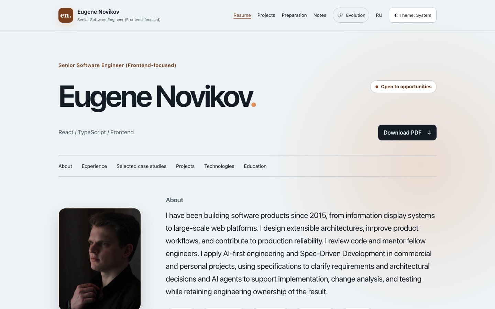
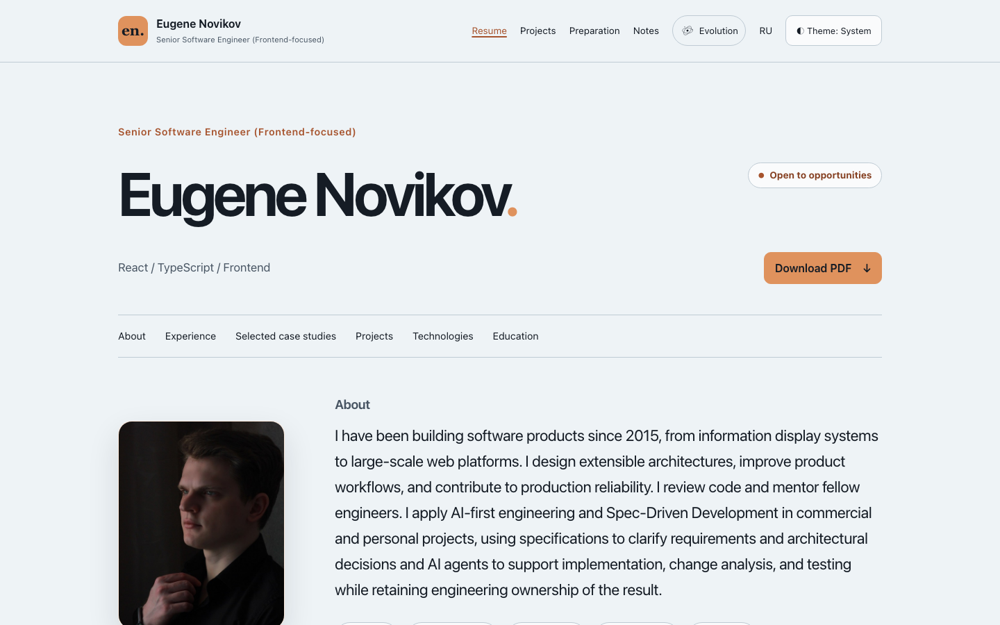
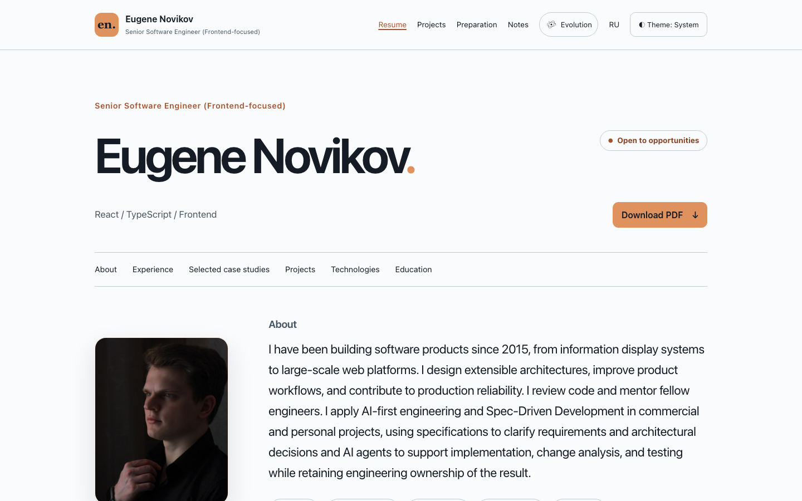
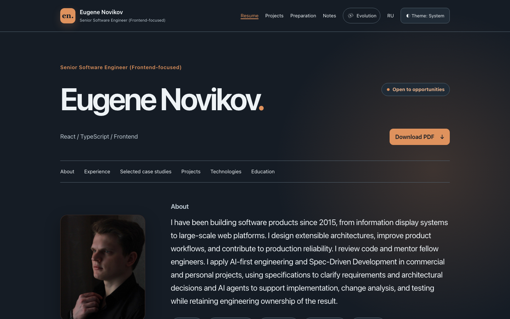
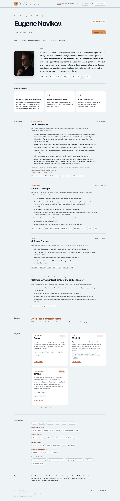
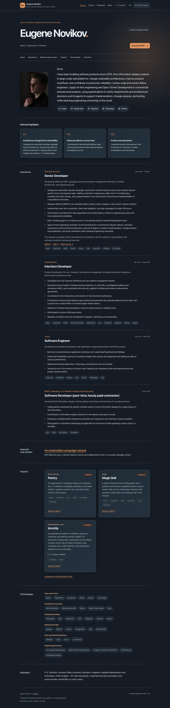
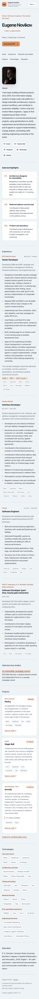
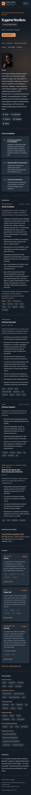
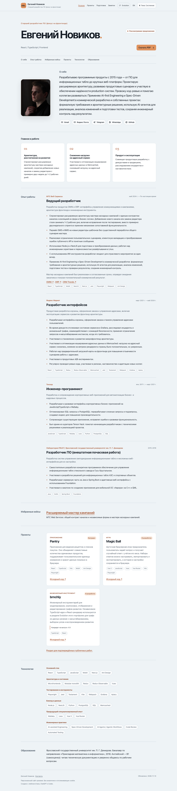
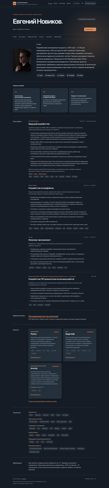

# Industrial Arctic visual alignment

## Audit and reference

The portfolio already had semantic light/dark variables, persisted theme selection, print overrides, deterministic PDF generation, and local OG generation. The first Industrial Arctic pass correctly introduced the four primitives, but its light theme diverged from the approved visual language:

- a page-level Copper radial glow created a warm beige/brown cast;
- dark derived Copper was reused too broadly for personal identity and controls;
- cards used gradients and colored shadows instead of flat engineered surfaces;
- the primary button and personal `en.` mark did not use original Copper consistently;
- print styling was changed before the site direction had been approved.

The local reference repository was available at `/Users/no_ovie/Repos/norilsk-standart-brand` (repository directory spelling retained). Its `src/tokens/index.ts`, Brand Preview v0.2.0 styles, color documentation, visual principles, and typography notes were inspected read-only at commit `fcfb09c`. They confirm the Graphite/Arctic structural pair, Nickel hierarchy, controlled Copper accent, flat page background, and candidate-only typography status. The brand repository was not modified or added as a dependency.

The current system font stack remains because the reference lists IBM Plex Sans, Manrope, and Inter as unapproved candidates requiring separate font-file and license work. Existing content, routes, typography scale, spacing, image, and component structure remain unchanged.

## Primitive and semantic tokens

Approved primitives remain unchanged:

- Graphite `#151C25`
- Nickel `#BFCBD4`
- Copper `#DF925D`
- Arctic `#EEF3F6`

The light candidate in `src/styles/tokens.css` now uses:

| Purpose           | Value              |
| ----------------- | ------------------ |
| Page background   | Arctic `#EEF3F6`   |
| Surface           | `#FAFBFC`          |
| Elevated surface  | `#FFFFFF`          |
| Primary text      | Graphite `#151C25` |
| Secondary text    | `#485563`          |
| Border            | Nickel `#BFCBD4`   |
| Subtle border     | `#D5DEE5`          |
| Decorative accent | Copper `#DF925D`   |
| Text accent       | `#A6532D`          |
| Accent surface    | `#F8E7DA`          |
| Primary button    | Copper / Graphite  |
| Personal mark     | Copper / Graphite  |

Light-theme page glow, card gradients, and colored card shadows are disabled. The approved dark theme keeps its previous token values, radial background, gradients, shadows, hierarchy, and button treatment. Four before/after dark screenshots have identical SHA-256 hashes.

The favicon and visible `en.` personal mark use original Copper with Graphite text in both themes. No corporate name, logo, slogan, or monogram was introduced.

Print/PDF alignment is explicitly deferred. The initial print recoloring was removed; protective print overrides retain the pre-alignment print palette so web tokens do not leak into generated PDFs. No résumé content or PDF structure changed.

## Comparative preview

All four candidates use the same EN content, 1440×900 viewport, scale, and top-of-page scroll position. Overrides for A and C exist only in `scripts/capture-visual-refresh.ts`; there is no production preset switch.

| Variant                    | Preview                                                    | Assessment                                                                                        |
| -------------------------- | ---------------------------------------------------------- | ------------------------------------------------------------------------------------------------- |
| A. Previous light baseline |  | Warm glow, brown mark, gradient cards, Graphite button. Does not match the refined specification. |
| B. Arctic Industrial       |    | Arctic background, original Copper accents, flat surfaces. Preferred candidate.                   |
| C. Arctic Paper            |              | `#FAFBFC` page background; clean but less distinctly Arctic.                                      |
| D. Approved dark           |            | Frozen approved theme; visually unchanged.                                                        |

Recommendation: select **B — Arctic Industrial**. It has the clearest relationship to the approved dark theme and Brand Preview while retaining a cold-metal character. C is a valid fallback if the owner prefers a more neutral paper-like canvas. The owner makes the final selection; the current implementation is a review candidate and has not been published.

## RU/EN and responsive matrix

The `after/` directory contains full-page captures for RU/EN, light/dark, 1440px desktop, and 375px mobile. `dark-regression-before/` contains the frozen dark references.

| View       | Light                                                | Dark                                               |
| ---------- | ---------------------------------------------------- | -------------------------------------------------- |
| EN desktop |  |  |
| EN mobile  |     |     |
| RU desktop |  |  |
| RU mobile  |     |     |

## Contrast

Calculated WCAG contrast ratios for applicable text combinations:

| Combination                       |   Ratio |
| --------------------------------- | ------: |
| Graphite on Arctic                | 15.34:1 |
| Secondary text on Arctic          |  6.82:1 |
| Accent text on Arctic             |  4.82:1 |
| Graphite on Copper primary button |  6.86:1 |
| Nickel on Graphite                | 10.38:1 |
| Dark accent text on Graphite      |  9.92:1 |

The same combinations are protected by `scripts/brand-assets.test.ts`. Raw Copper remains decorative on light backgrounds and is not used for small text.

## Regeneration

The screenshot command intentionally does not build first:

```sh
npm run screenshots:visual -- comparison
npm run screenshots:visual -- after
```

Build first only when the current production candidate should replace the screenshot source.
